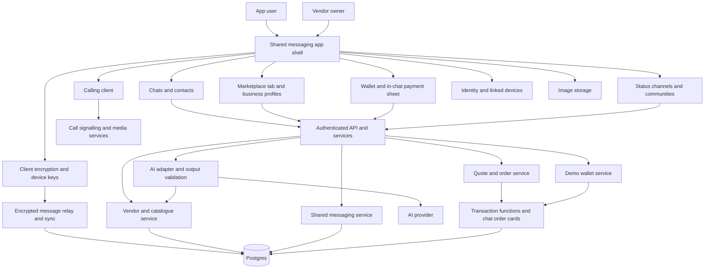
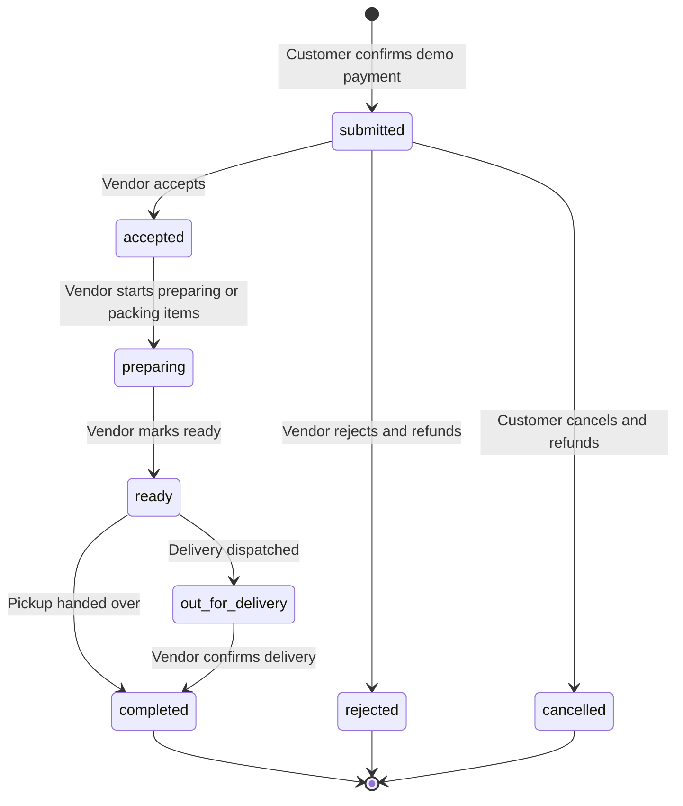

# WhatsApp Marketplace — WhatsApp Rebuild with Marketplace and Wallet

A rebuild that retains all existing WhatsApp features and adds an integrated general marketplace, AI-assisted ordering, and an in-app wallet. Otukpo is the local demo context.

**Builder:** solo. **Planning date:** 19 October 2026. **Scope corrected:** 20 October 2026. **Status:** implementation blueprint. This document is the sole brief for WhatsApp Marketplace; existing MarketMate application files are outside this work.

## Presentation decisions — 21 October 2026

The presentation remains an **independent WhatsApp-style prototype**. Use demo users with Nigerian names and fictional profile pictures, remember the selected session, and avoid requiring signup/login for those demo users. Real WhatsApp account integration is planned for a later feasibility and implementation phase; the prototype does not inherit a real WhatsApp login or modify the WhatsApp application.

**Everyone can sell:** provide a visible **Sell something** action inside the messenger/marketplace. A user posts a product directly; create their seller profile automatically on their first listing. Full business tools remain available but are not a prerequisite to finding the selling action.

**Wallet transfers work without a purchase:** each user has a unique `@username` payment address backed by an immutable internal user ID. Open a contact profile and tap their username or Send money, or look up an exact username in Wallet. Show the recipient's name, username and exact amount before explicit confirmation. Debit and credit atomically with idempotency, record the balanced ledger, and show the transfer receipt in both users' shared conversation and wallet histories. Reject self-transfers, unknown/mismatched recipients, invalid amounts and insufficient funds. Usernames cannot be renamed or reassigned in this prototype. Receive money shows a shareable username. All funds remain clearly labelled as simulated.

These additions supersede earlier statements that tied wallet use exclusively to marketplace orders. Retained WhatsApp features remain required for the complete product; this event prototype reports pending features honestly.

## Implementation direction

**Rebuild the messaging application first.** The opening screen is the chat list. Personal conversations work independently of commerce. Marketplace discovery, vendor profiles, AI order assistance, and wallet payments live inside the same messaging application.

**User requirement: all existing WhatsApp features remain in scope.** Retain the existing messaging, calling, Updates/Status, groups, communities, channels, account, privacy, security, and device experiences. The marketplace, order assistant, and wallet are additions. Implementation phases describe work order and do not authorise removing baseline features. A commerce demo or a text-only messenger is not completion of the requested application.

The earlier version of this blueprint incorrectly made the marketplace the primary product and put messaging later in the roadmap. This revision replaces that direction. Build a WhatsApp-inspired prototype with the new features integrated into its navigation and conversations. A standalone storefront does not fulfil this brief.

The client can be delivered as a responsive web prototype for the challenge, but its structure and interaction must be those of a messaging app. This is an independent rebuild concept; modifying the actual WhatsApp application is not an implementation dependency.

## 1. Product idea

WhatsApp Marketplace reimagines the WhatsApp messaging experience by adding a place to discover businesses beyond existing contacts, open their business profiles, and start conversations. People can also use it for ordinary personal messaging. Inside a business conversation, they can browse a seller’s product catalogue, ask AI to prepare an accurate order, and pay through the app's wallet.

Existing WhatsApp functionality stays available alongside this journey. Users must be able to continue using the messenger without entering the marketplace or becoming a vendor.

Any seller can register and publish a business profile in the integrated marketplace. The five vendors used in the challenge demo are sample data, not a membership limit. Each vendor owns their profile, catalogue, business conversations, and orders. Opening a vendor from the marketplace leads to a conversation in the same application.

The marketplace supports buying and selling across product categories, including electronics, fashion, groceries, home goods, and food. Fast food is one category, not a product boundary. Otukpo provides local demonstration context, not a hard-coded marketplace location restriction. Sellers specify their location and supported fulfilment areas.

### Problem and intended value

The rebuild explores how a familiar messaging application could support business discovery and transactions within the conversation experience. Customers need to find vendors beyond their existing contacts and understand what is available, what it costs, and how to order. Vendors need visibility and a manageable flow from enquiry to fulfilment.

WhatsApp Marketplace makes discovery, product catalogues, ordering, and payment features of the messenger. AI helps interpret what the customer wants; application code validates the order and calculates its price. Customer demand and vendor willingness to adopt the product remain hypotheses to validate with local users.

### Product promise

> Chat as usual. Discover a business, order with AI, and pay without leaving the conversation.

## 2. Challenge context

The Talent Nation AI Rebuild Challenge is scheduled for **Wednesday, 21 October 2026**, with Otukpo among its participating campuses. Registration is free; campus prizes are ₦300,000, ₦200,000, and ₦100,000. Registration does not guarantee a competition place. [Registration form](https://docs.google.com/forms/d/e/1FAIpQLSdMblpnNj2KSsYHdyEiu3Ty0AD_NioSSDjwC8Be4gdppUzJew/viewform)

An organiser reply reproduced on a [public mirror of the Learn2Earn X feed](https://www.sotwe.com/learn2earnNG?lang=id) describes building and showcasing on the same day. Treat the roadmap below as a build sequence. Confirm the event's start time, exact venue, preparation rules, and available build hours before assigning a timetable.

## 3. Users and ownership

“Seller” and “vendor” refer to the same role throughout this brief. The proposed `vendors` entity represents sellers of any supported product category, not only food businesses. Any app user can buy and can onboard to sell through the same account.

| User | What they can do |
| --- | --- |
| App user | Keep access to the full retained WhatsApp feature set and open the additional Marketplace or Wallet features from the same application. |
| Customer | Discover vendors, open their business profiles, chat, use the assistant, review an order, pay from a demo wallet, and view order history. |
| Vendor owner | Publish a business profile and catalogue, set availability and delivery zones, receive enquiries in their chat list, and manage their own orders through business tools. |

A person can be an ordinary messaging user, a customer, and a vendor owner through the same account. For the MVP, one owner manages one business profile. A vendor account does not grant access to another vendor's data. Staff accounts and an administration dashboard are later features.

## 4. Scope and priorities

### WhatsApp feature retention is a requirement

Preserve the full existing feature set. The inventory below groups the work; it is not an exhaustive substitute for auditing the reference app. Create a tracked checklist for each individual behaviour, its reference platform/release, implementation state, and verification. Record platform and regional differences explicitly. Newly discovered baseline features join the checklist rather than being excluded because this table did not name them.

| Feature family | Retained capability to inventory and implement |
| --- | --- |
| Chats and contacts | Personal conversations, contact management, chat search/filters, unread state, delivery/read receipts, presence controls, archived/pinned/locked chats, and notifications. |
| Message actions | Replies/quotes, forwarding, reactions, editing/deletion, starred messages, disappearing messages, and applicable view-once behaviour. |
| Rich messages | Photos, video, documents, voice notes, video notes, stickers, GIFs, emoji, contacts, location/live location, and polls. |
| Calling | Voice/video calls, group calls, call history, links/invitations, in-call controls, and screen sharing, plus applicable newer calling behaviours. |
| Groups and communities | Group creation/membership, invites, administrator controls, announcements, communities and their linked groups, and related interactions. |
| Updates | Status creation/viewing/replies/audience controls and channels with their publishing/following interactions. |
| Account and devices | Profile/settings, identity verification, contacts access, linked devices, sync, backups/restoration/transfer, and applicable account switching. |
| Privacy and security | End-to-end encryption for the protected communication types, blocking/reporting, privacy controls, chat lock, account protection, and security notifications. |
| Existing assistant and personalisation | Preserve applicable existing assistant entry points and personalisation; add the order assistant as a distinct contextual capability. |

Use official feature references during the audit: [Messaging](https://www.whatsapp.com/messaging), [Calling](https://www.whatsapp.com/calling), [Groups](https://www.whatsapp.com/groups), [Communities](https://www.whatsapp.com/communities/learning/), [Channels](https://www.whatsapp.com/channels), [Status](https://www.whatsapp.com/status), and [Privacy/Security](https://www.whatsapp.com/security). These references cover feature families; they do not establish that this proposed rebuild has implemented them.

### Additions inside the existing experience

Marketplace business discovery, seller profiles/product catalogues, contextual AI ordering, in-chat order cards, and the wallet extend the retained app. Product categories and seller locations are configurable; ordinary messaging remains independent of commerce.

### First implementation slice: messaging and commerce

The following table describes an initial vertical slice. It does not redefine the complete product or remove the retained features listed above.

| Area | Required behaviour |
| --- | --- |
| Messenger shell | Open on Chats and retain existing navigation/features, including Updates and Calls. Add Marketplace and Wallet in the same app shell. |
| Contacts and personal chats | Add another registered demo user as a contact; start a one-to-one conversation; send, persist, and receive ordinary text messages. |
| Chat interaction | Show message bubbles, composer, timestamps, and actual unread/read state; support returning to the chat list and reopening the same thread. |
| Marketplace | An in-app tab lists published sellers across product categories; search by seller or product, filter by category/location, and see accepting-orders status. |
| Vendor onboarding | An app user can publish a business profile and at least one priced product through account business tools. |
| Vendor profile | An in-app business profile shows description, location, catalogue, hours, pickup/delivery options, zones, and fees. Its primary action opens the internal business chat. |
| AI assistance | Interpret a request, suggest eligible products, prepare an editable cart, and ask for missing details. |
| Business conversations | Persist customer/vendor text messages in the same messaging system as personal chats. Clearly label assistant responses and order cards. |
| Checkout in conversation | Show an editable order card and confirmation sheet attached to the business chat; support one vendor, a server-calculated quote, and delivery details where needed. |
| Demo wallet | Add test funds, pay, display balance/history, and refund rejected or eligible cancelled orders. |
| Business tools | Edit catalogue/availability and manage orders inside the app; an incoming order is also reachable from its business conversation. |
| Order tracking | Show payment, receipt, and fulfilment updates on the conversation's order card, with a detail view when opened. |
| Persistence | Contacts, personal/business messages, profiles, orders, and wallet entries survive refresh and sign-in. |

### Commerce boundaries and implementation order

- A working messenger is the foundation; the integrated marketplace supports multiple product categories and seller locations.
- Five fictional, clearly labelled sellers spanning different product categories for the demo, plus working self-service seller onboarding. Sample sellers do not limit marketplace membership or categories.
- One vendor per cart and order. Switching vendors requires the customer to confirm replacing the cart.
- Simple priced products and bundles. Treat differently priced sizes, colours, conditions, or options as separate listings initially; record their attributes explicitly.
- Vendor-managed pickup or delivery. Customers choose a configured delivery zone; the app does not calculate live road distances.
- Availability is an in-stock/out-of-stock flag, not a quantity-based inventory system.
- Customer wallet payments use test funds. Vendor earnings are a demo accounting summary; bank withdrawals are later work.
- Text messaging can be the first implementation step; rich messages, groups, calling, and the other baseline features remain required work. Message arrival must work across signed-in sessions without manual page reloads.
- Registered-user lookup can seed a demo. Device contacts, notifications, and linked-device behaviour remain part of the retained baseline and need platform integration.

### Commerce expansion after the initial slice

Live wallet funding/withdrawals, rider dispatch/maps, multi-vendor checkout, ratings/disputes, promotions, staff permissions, and advanced marketplace discovery and fulfilment coverage extend the initial commerce slice. Existing WhatsApp features are not part of this optional expansion list.

The previous server-readable message design does not fulfil the required encryption baseline. Replace that assumption with client-side encryption and explicit, user-approved AI handoff as described in section 7. A partially implemented prototype must report its actual capabilities honestly while the full feature set remains required.

## 5. User journeys

### Ordinary messaging

1. Sign in and land on Chats.
2. Open a saved conversation or use New chat to find another registered demo user.
3. Send a personal message; the other user's session receives it through polling or subscriptions.
4. Return to Chats and see the latest message preview and unread state.
5. Reopen the thread after refresh and see its saved history.

### Customer discovering a business

1. Open Marketplace from the messenger navigation and browse sellers and products across categories, or describe a need to the discovery assistant.
2. Open an in-app business profile and inspect its catalogue and fulfilment options.
3. Tap **Message** to open the vendor's internal business conversation; finding the vendor does not require an existing saved contact.
4. Send a message and optionally invoke the order assistant using that vendor's actual catalogue.
5. Review the proposed order card in the conversation. Edit items and choose pickup or delivery.
6. Open the chat's confirmation sheet, provide missing details, and review a fresh priced quote.
7. Fund the demo wallet if needed, return to the same order, and explicitly confirm payment.
8. See the saved order card, receipt link, and subsequent fulfilment status in the conversation.

No external WhatsApp handoff or pasted conversation is needed for the primary flow. The rebuilt app owns its messaging experience and the connection from business discovery to chat to payment.

### Vendor

1. Sign up to the messenger, open account settings, and choose **Become a vendor**.
2. Create a seller profile with its location and supported fulfilment options; choose categories for its product listings. Do not fix the category to food or the location to Otukpo.
3. Add products, prices, availability, pickup details, and optional delivery zones and fees.
4. Publish the business profile once required information is complete.
5. Receive business conversations in Chats and see paid demo order cards there and in business tools.
6. Accept an order or reject it with a reason; rejection triggers the demo refund.
7. Update preparation and fulfilment progress.
8. Mark the order completed after fulfilment; see the resulting demo earnings entry.

### Wallet

The wallet also supports standalone username-addressed peer transfers as specified in the presentation decisions above. Marketplace payments retain the order-clearing lifecycle below.

1. A user opens Wallet from the messenger navigation or a business chat's payment sheet and sees **Demo wallet — test funds**.
2. They choose a bounded test top-up amount.
3. The server creates a unique top-up transaction and updates the balance atomically.
4. Checkout moves the order amount from the customer account to an internal demo clearing account.
5. Completion moves that amount to the vendor's demo payable account.
6. Rejection or cancellation before acceptance returns the amount to the customer.

These are simulated accounting movements. They do not represent a bank transfer, a live payment, or a real escrow service.

## 6. Screens and navigation

| Route | Purpose |
| --- | --- |
| `/` | Resolve sign-in and open Chats as the default app screen. |
| `/sign-in` and `/sign-up` | Authentication and return to the intended page. |
| `/chats` | Personal and business chat list, unread counts, search, and New chat. |
| `/chats/new` | Saved contacts and lookup of another registered demo user. |
| `/chats/[id]` | Personal or business conversation, message composer, and contextual business/assistant actions. |
| `/updates` | Retained Status and Channels experience and its related screens. |
| `/calls` | Retained call history, call initiation, invitations, and active-call interface. |
| `/communities` | Retained communities and their group/announcement flows. |
| `/groups/[id]` | Group conversation, membership, information, and administrator controls. |
| `/marketplace` | Integrated vendor discovery, filters, and natural-language search. |
| `/marketplace/vendors/[slug]` | In-app business profile, catalogue, delivery information, and Message action. |
| `/chats/[id]/checkout` | Conversation-scoped order/quote confirmation sheet; preserve the underlying chat context. |
| `/wallet` | Demo balance, test top-up, and transaction history. |
| `/orders` and `/orders/[id]` | Order history and receipt/progress details, reachable from Wallet or a chat order card. |
| `/profile` | Personal profile, contacts/settings, and business-account entry point. |
| `/business/onboarding` | Publish a business profile from the app's account tools. |
| `/business` | Vendor order queue and demo earnings, with links back to business chats. |
| `/business/products` | Product creation, editing, pricing, and availability. |
| `/business/profile` | Business information, hours, delivery zones, and accepting-orders switch. |

Retain the familiar WhatsApp navigation and access to **Chats, Updates, Calls, Communities, and settings** on the applicable reference platform. Add Marketplace and Wallet without replacing those entry points; their exact placement must fit the reference layout rather than forcing every destination into one crowded tab bar. On desktop, retain the conversation list and active-thread layout. Keep business profiles, product catalogues, and payment sheets inside the shared shell. Existing features require working flows, not decorative tabs; report unfinished items as pending instead of deleting them from scope.

## 7. Proposed architecture

Use a shared messaging core with marketplace, business ordering, and wallet modules inside the application. The proposed Next.js/Supabase stack below is a starting point for the web client and commerce services, not a complete architecture for WhatsApp feature parity. Add the communications, encryption, device, and update services below before calling the complete application finished. A web client alone does not establish native device-feature parity.

| Layer | Proposed choice | Responsibility |
| --- | --- | --- |
| UI and server | Next.js App Router + TypeScript | Messaging app shell, chat screens, integrated marketplace/wallet, API routes, and business services. |
| Styling | Tailwind CSS | Familiar messaging layout, conversation bubbles, business profile panels, and order/payment sheets. |
| Identity | Supabase Auth | User registration, sign-in, and verified server-side identity. |
| Database | Supabase Postgres | Contacts, memberships/read state, encrypted message envelopes and metadata, business data, quotes, orders, and ledger. |
| Media storage | Object storage with authorised access | Encrypted private attachments; separately managed public business/product images. |
| AI | A server-only provider adapter | Convert requests into structured constraints or proposed cart changes. |
| Message transport | Realtime delivery with reconnect/catch-up | Deliver message envelopes, receipts, presence, and order-card notifications; polling is a temporary prototype transport. |
| Tests | Unit tests plus database/API integration checks | Personal/business chat isolation, message persistence, pricing, order transitions, and wallet consistency. |

Next.js Route Handlers support the proposed API layer. Authenticate and authorise each protected operation because those handlers are public endpoints. [Next.js documentation](https://nextjs.org/docs/app/guides/backend-for-frontend)



The model proposes intent and item selections. Only authenticated application services can create quotes, place orders, or move wallet balances. The database remains the source of truth for commerce records. For private communications it stores encrypted envelopes and necessary routing metadata, not general plaintext chat history.

### Required services beyond the initial commerce skeleton

- **Client encryption and devices:** select a vetted protocol/implementation; manage device identity, key exchange, membership changes, encrypted attachments, verification, and device revocation. This design work and its tests are mandatory; do not substitute custom cryptography or claim encryption from database access controls.
- **Message delivery and sync:** add reconnect/catch-up, offline delivery, receipts, presence/privacy, push notifications, and linked-device synchronisation. Bound access by device and conversation membership.
- **Calling:** add a calling client, authenticated signalling, connectivity/relay infrastructure, and group-media support. Track voice/video, call links/history, controls, and the remaining audited calling behaviours individually. The concrete media stack remains a technical selection, not an implemented capability.
- **Groups and communities:** generalise membership and roles beyond two people; enforce invite/admin rules and membership-change history.
- **Status and channels:** implement publication, expiry/audiences, subscriptions/followers, permitted reactions/replies, and privacy appropriate to each feature type.
- **Media and location:** handle capture/upload/download/playback, attachment access/expiry, voice/video notes, and permission-controlled location sharing.
- **Account lifecycle:** support the audited contact, identity, device, settings, security, backup, restoration, and transfer flows on each target platform.
- **AI privacy boundary:** the client explicitly selects and shares business-order context after user action. An AI request can disclose that selected context to the service/provider; it does not grant blanket access to encrypted chat history. Personal chat contents and keys stay outside the ordering assistant's access.

The concrete cryptographic, calling, and multi-device specifications remain required follow-on design work. This document records that requirement; it does not certify feature parity or a completed security design.

### Module boundaries

- **Identity and contacts:** resolve the authenticated user, their saved contacts, and optional business ownership.
- **Messaging:** manage direct/group/business threads, membership, encrypted envelopes, client-rendered previews, receipts/unread state, and references to authenticated order records.
- **Marketplace:** publish business profiles, edit product catalogues, check availability, and provide eligible discovery results inside the messenger.
- **AI:** operate on explicitly shared business-order context or a discovery request, with no chat decryption keys and no direct write access to ordering/wallet operations. Personal threads are outside its input scope.
- **Quotes and orders:** attach a quote/order to its business thread, calculate totals, validate checkout, and enforce fulfilment transitions.
- **Wallet:** maintain demo accounts and an append-only ledger through transactional operations.

## 8. Data model

Use UUID identifiers, UTC timestamps, and integer kobo for NGN amounts. Display times in `Africa/Lagos`. Treat all wallet accounts and transactions in this prototype as demo mode.

| Entity | Important fields |
| --- | --- |
| `profiles` | `id` linked to auth user, `display_name`, avatar path, optional phone, timestamps. |
| `contacts` | `owner_id`, `contact_user_id`, optional nickname; unique owner/contact pair. |
| `vendors` | `id`, unique `owner_id`, unique `slug`, business name, description, supported categories, city, address, opening hours, `accepting_orders`, `published_at`. |
| `delivery_zones` | `id`, `vendor_id`, name, `fee_kobo`, active flag. |
| `products` | `id`, `vendor_id`, category, name, description, condition, structured attributes (such as size, colour, or compatibility), tags, image path, `price_kobo`, available flag, archived flag. |
| `conversations` | `id`, kind (`direct`, `group`, or `business`), canonical direct-user pair key or business `customer_id`/`vendor_id`, group metadata, timestamps; unique personal pair or customer/vendor business pair. |
| `conversation_participants` | `conversation_id`, `user_id`, membership role/state, join/leave timestamps, receipt/read state; unique active membership pair. |
| `messages` | `id`, `conversation_id`, sender/device identity, author/message kind, encrypted content envelope for private user messages, permitted metadata, optional `order_id`, timestamp. Render/decrypt private bodies on authorised clients. |
| `quotes` | `id`, `conversation_id`, `customer_id`, `vendor_id`, fulfilment mode, zone/address/contact snapshot, subtotal, delivery fee, total, `expires_at`, nullable `consumed_order_id`. |
| `quote_items` | `id`, `quote_id`, `product_id`, name/condition/attributes snapshot, quantity, unit-price snapshot. |
| `orders` | `id`, unique `quote_id`, `conversation_id`, `customer_id`, `vendor_id`, fulfilment/contact/address snapshots, total snapshots, `status`, `payment_status`, timestamps. |
| `order_items` | `id`, `order_id`, `product_id`, name/condition/attributes snapshot, quantity, unit-price snapshot, line total. |
| `order_events` | `id`, `order_id`, actor, previous/next status, reason, timestamp. |
| `wallet_accounts` | `id`, optional customer/vendor owner, account kind, currency, mode, cached `balance_kobo`. |
| `ledger_transactions` | `id`, kind, initiating user, operation key, request hash, optional `order_id`, timestamp. |
| `ledger_entries` | `id`, `transaction_id`, `account_id`, signed `amount_kobo`. |

The table specifies the commerce core and the start of messaging storage. Full retention additionally requires schemas for devices/key bundles, attachment metadata, message actions/receipts, user privacy settings, call sessions/participants, groups/communities, statuses/audiences, channels/subscriptions, and backup/sync state. Their detailed migrations and access rules are pending design work, not features removed from scope. Private plaintext bodies and decryption keys must not be introduced into server tables as a shortcut.

### Relationships

- Every registered user can have contacts and direct conversations independently of vendor/customer status.
- Direct and initial business conversations have two members. Groups support multiple members and administrator permissions; communities organise their related groups. Generalise membership rather than enforcing a two-user limit across the application.
- An owner has one business profile; a vendor has many products, zones, business conversations, and orders.
- A customer has many quotes/orders and one customer demo wallet account.
- A quote/order belongs to exactly one vendor and the matching business conversation.
- An order card references its saved order; status and payment details render from the authoritative order record.
- A quote can be consumed once; the order keeps its own immutable item and price snapshots.
- A ledger transaction contains balanced entries across accounts.

### Constraints and access

- Enforce positive bounded quantities, non-negative item prices/fees, and valid state values in the database.
- Only conversation members can read messages or send text as themselves. Only server operations can author assistant/system messages or attach order cards.
- Enforce that the quote/order customer and vendor match the linked business conversation. Direct conversations cannot carry vendor orders or invoke the order assistant.
- Only the reading participant can advance their read marker; calculate unread counts from saved messages and that marker.
- Reject products and delivery zones belonging to another vendor, even if their IDs are valid.
- Archive products instead of deleting records referenced by historical orders.
- Make ledger entries append-only; corrections use a compensating transaction.
- Use unique operation keys scoped to the authenticated user and operation. The same key with a different request body is a conflict.
- Allow one checkout transaction and at most one terminal refund or settlement transaction per order.
- Restrict table writes so only the designated transaction functions can change balances, orders, payment states, and ledger entries.

Enable Postgres Row Level Security for exposed tables. Published business/product data can be discoverable, while personal profiles expose only the minimal registered-user lookup fields. Contacts, threads, messages, read markers, and orders require ownership or participation. Keep financial entries private to their account owner. A vendor can see order contact details for their orders, but cannot see the customer's wallet balance or unrelated personal chats. [Supabase RLS documentation](https://supabase.com/docs/guides/database/postgres/row-level-security)

## 9. AI behaviour

### Discovery mode

Example: **“Two USB-C cables under ₦6,000 including delivery.”**

1. Parse item preferences, quantities, budget, and fulfilment intent into a validated structure.
2. Ask the customer to select a delivery zone if location/fee information is missing.
3. Filter actual published sellers and available products by requested category, location, attributes, condition, and budget. Ask for missing compatibility or variant details rather than assuming them.
4. Calculate candidate totals in application code, including delivery when requested.
5. Return eligible options with the price breakdown and a link to the in-app business profile; Message opens its internal business chat.
6. If nothing meets the request, explain the constraint and ask whether the customer wants to change it.

### Vendor order mode

1. After the customer invokes the assistant in a business chat, validate their membership and load the vendor's catalogue/current draft. The authorised client explicitly shares selected business-order context; the service does not fetch and decrypt private conversation history.
2. Ask the model for proposed item IDs, quantities, requested changes, and clarification questions.
3. Validate the structured result against the vendor's real catalogue and quantity limits.
4. Show proposed changes on an editable order card in the same conversation.
5. After review, create a fresh quote through the normal pricing service and open the in-chat confirmation sheet.

The assistant must distinguish **“add one more”** from **“make it three in total”** and retain the customer's latest explicit correction.

### Output boundary

```json
{
  "intent": "draft_order",
  "vendor_id": "vendor-uuid-from-request-context",
  "items": [
    { "product_id": "product-uuid-from-catalogue", "quantity": 2 }
  ],
  "fulfilment": "delivery",
  "delivery_zone_id": null,
  "clarifications": ["Which delivery zone should we use?"]
}
```

Treat this as an example contract. IDs must resolve to the current vendor; prices, totals, payment status, and account balances are excluded from model authority. Validate every response against a schema. The model cannot execute SQL, issue payments, or mark an order accepted.

### Failure behaviour

- An unavailable model or invalid output leaves manual search and ordering usable.
- Never invent a vendor, product, price, available stock, delivery promise, or verification badge.
- Treat catalogue descriptions and messages as untrusted content, including instructions embedded in them.
- Send only the catalogue and conversation context needed for the request; omit wallet credentials, balances, and unnecessary personal details.
- Do not send ordinary personal conversations to the AI provider. Participation in a business chat does not grant access to other threads.
- Pre-recorded examples may support a backup demo only when visibly labelled as examples.

## 10. Pricing, checkout, and wallet accounting

### Pricing rules

```text
line_total_kobo = quantity × current_product_price_kobo
subtotal_kobo   = sum(line_total_kobo)
delivery_kobo   = selected_vendor_zone_fee, or 0 for pickup
total_kobo      = subtotal_kobo + delivery_kobo
```

No platform commission or additional service fee is included in the MVP. Keep all calculations on the server using integer amounts. Never trust totals, ownership IDs, or payment success supplied by the browser or the model.

Create quotes with a five-minute lifetime. Checkout revalidates vendor availability, item availability/prices, delivery fees, and customer ownership. If the price changed, return a replacement quote for explicit confirmation. Do not silently charge the new amount.

### Accounts and transaction effects

`+` increases an account's balance; `-` decreases it. Each ledger transaction sums to zero. The demo source account is the only account allowed to be negative.

| Event | Account movements |
| --- | --- |
| Demo top-up | Demo source `-amount`; customer wallet `+amount`. |
| Place order | Customer wallet `-total`; demo order clearing `+total`. |
| Complete order | Demo order clearing `-total`; vendor payable `+total`. |
| Reject/cancel before acceptance | Demo order clearing `-total`; customer wallet `+total`. |

Vendor payable includes the delivery fee because the vendor fulfils delivery in this version. The payable balance is an illustrative earnings balance; there is no withdrawal action in the MVP.

### Atomic checkout

Implement checkout in one database transaction, exposed through a restricted database function:

1. Resolve the user from the verified session on the server.
2. Reserve the user-scoped idempotency key; reject a mismatched request hash or return the existing successful result.
3. Lock the quote, catalogue rows required for pricing/availability, and affected wallet accounts. Use a consistent lock order across operations.
4. Verify the quote belongs to the customer and matching business conversation, is unused/unexpired, and is still valid; reject mixed-vendor items and unsupported fulfilment.
5. Recalculate totals and check the customer's spendable balance.
6. Create the order, immutable item snapshots, balanced ledger transaction, cached balance changes, initial order event, and one server-authored order-card message in the business conversation.
7. Mark the quote consumed and commit everything together.
8. Return the saved order, order-card message ID, and server-authoritative wallet balance to the conversation UI.

A failure rolls back all changes. A retry after a network timeout returns the original order rather than creating a second debit. Completion, rejection, and cancellation use the same atomic approach while locking the order so concurrent actions cannot both succeed.

Postgres database functions can be invoked through Supabase RPC. Restrict execution to the server's intended role, explicitly check the verified actor inside privileged operations, and keep service credentials server-only. Row locks provide the mechanism for serialising conflicting wallet/order mutations. [Supabase database functions](https://supabase.com/docs/guides/database/functions), [Postgres locking](https://www.postgresql.org/docs/current/explicit-locking.html)

### Live payments after the challenge

Keep future provider operations behind a payment adapter. Live funding requires verified provider events, idempotent crediting, reconciliation, refunds, and a defined vendor payout model. Keep live and demo accounts separate. A dedicated virtual account can support wallet funding; it does not replace the application's ledger. [Monnify reserved-account documentation](https://support.monnify.com/topics/payment-collection-196)

## 11. Order lifecycle

This lifecycle applies across product categories. `preparing` means preparing or packing the ordered goods; it does not imply food preparation. Historical order items retain the purchased product name, selected attributes/condition, and price snapshots.



Allow `ready → completed` only for pickup and `ready → out_for_delivery → completed` only for delivery. Vendor owners perform fulfilment transitions. The customer can cancel only while the order is `submitted`; rejection is also limited to that state in this MVP.

Track payment separately: `held` when submitted, `settled` when completed, and `refunded` when rejected/cancelled. Every status change records its actor and time and updates the data rendered by the existing conversation order card. Completion settles the demo funds once. Refunds after acceptance and partial refunds require a later support workflow.

## 12. API surface

These are proposed contracts, not implemented endpoints. Protected routes derive identity from the verified session. Mutations validate input, ownership, and allowed state before writing.

| Endpoint | Responsibility |
| --- | --- |
| `GET/PATCH /api/profile` | Read/update the current user's messaging profile. |
| `GET /api/users/search` | Bounded lookup of registered demo users using minimal profile fields. |
| `GET/POST /api/contacts` | Read/add the current user's saved contacts. |
| `GET/POST /api/conversations` | List/create authorised direct, group, or business conversations with kind-specific membership rules. |
| `GET/POST /api/conversations/[id]/messages` | Relay authorised encrypted message envelopes and permitted structured business events with pagination; restrict system/card authorship. |
| `POST /api/conversations/[id]/read` | Advance only the current participant's read marker. |
| `GET /api/vendors` | Published vendors, product search, and accepting-orders filters. |
| `GET /api/vendors/[id]` | Public profile, catalogue, and delivery information. |
| `POST /api/vendors` | Create the authenticated owner's storefront. |
| `PATCH /api/vendors/[id]` | Owner updates profile, publishing, and availability. |
| `POST /api/vendors/[id]/products` | Owner creates a product. |
| `PATCH /api/products/[id]` | Owner updates or archives an item. |
| `POST/PATCH /api/vendors/[id]/zones` | Owner creates or updates delivery zones. |
| `POST /api/assistant` | Validated marketplace discovery or explicitly invoked business-chat suggestions; reject personal-thread context. |
| `POST /api/quotes` | Validate the business-chat draft and save a server-priced quote bound to that thread. |
| `POST /api/orders` | Consume a quote, debit the demo wallet, and create the chat order card atomically. |
| `GET /api/orders` | Customer order history or the owner's vendor queue. |
| `GET /api/orders/[id]` | Order detail for its customer or vendor owner. |
| `POST /api/orders/[id]/transition` | Enforce a fulfilment transition, settlement, or eligible refund. |
| `GET /api/wallet` | Current user's demo balance and paginated history. |
| `POST /api/wallet/demo-top-up` | Bounded test funding with an idempotency key. |

Require idempotency keys on order creation, top-ups, and financial transitions. Return useful error codes for authentication, ownership, invalid input, insufficient balance, changed/expired quotes, invalid transitions, and retryable upstream failures. Rate-limit assistant requests and bound message length, cart size, quantity, and top-up amounts.

This is the initial commerce API surface. The retained baseline also needs authenticated interfaces for calls/signalling, group/community administration, statuses/audiences, channels/subscriptions, media, message actions, device/key registration, sync, privacy/security settings, notifications, and backup/restore. Define those contracts alongside the feature inventory; their absence from this endpoint table does not exclude them from the product.

## 13. Suggested project structure

Create the application in a separate `orderdesk/` directory when implementation begins.

```text
orderdesk/
  src/
    app/
      (auth)/              # Sign-in and registration
      (messenger)/         # Shared app shell; default screen is Chats
        chats/             # Chat list, new chat, threads, and payment sheet
        calls/             # Retained calling flows and active-call interface
        updates/           # Retained statuses and channels
        groups/            # Retained group chat and administration
        communities/       # Retained community flows
        marketplace/       # In-app discovery and business profiles
        wallet/            # In-app test balance and transaction history
        orders/            # Details linked from chat cards and wallet
        profile/           # Account, contacts, and settings
        business/          # Vendor onboarding, product catalogues, and order tools
      api/                 # Validated request handlers
    components/
      messenger/           # App shell, chat list, bubbles, composer, unread state
      calls/
      updates/
      media/
      marketplace/
      vendor/
      orders/              # In-chat order cards and confirmation sheets
      wallet/
      ui/
    lib/
      auth/                # Server identity, membership, and ownership checks
      contacts/
      db/                  # User-scoped clients and restricted server client
      catalogue/           # Discovery, product catalogues, and vendor eligibility
      messaging/           # Shared personal/business messaging core
      encryption/          # Vetted client encryption and device-key integration
      calls/               # Signalling and media-service adapters
      updates/             # Status and channel services
      groups/              # Membership/community administration
      devices/             # Linked-device sync, notifications, account lifecycle
      ai/                  # Provider adapter, schemas, and prompts
      orders/              # Quotes, pricing, and transitions
      wallet/              # Ledger/RPC adapter and balance reads
      validation/
    types/
  supabase/
    migrations/            # Schema, access policies, and transaction functions
    seed.sql               # Personal contacts/chats, fictional vendors, product catalogues, accounts
  tests/
    unit/
    integration/
    e2e/
  public/
  .env.example             # Variable names and placeholders only
  README.md                # Setup, migration, seed, test, and deployment commands
```

Separate secrets for the AI provider and privileged database client from browser-safe configuration. No API keys belong in committed files or client bundles.

## 14. Solo implementation roadmap

Build in phases while retaining every baseline feature as required work. Phase completion is not full product completion. The event demo can show implemented slices, but must identify unfinished functionality accurately. Attach dates only after the baseline audit and technical choices establish realistic effort.

| Phase | Deliverable | Finish condition |
| --- | --- | --- |
| 1. Baseline audit and architecture | Inventory the reference app, map every feature to acceptance checks, and select encryption/calling/device foundations. | All baseline features are tracked; unresolved designs are explicit; no feature is silently dropped. |
| 2. Messaging foundation | Account identity, retained app shell, contacts, encrypted direct messaging, delivery/read state, media, and message actions. | Verified cross-session messaging works with the required privacy boundaries and persistent history. |
| 3. Retained communication and account features | Groups/communities, calls, Updates/Status/channels, notifications, linked devices, settings, security, and backup/restore. | Each implemented behaviour passes its inventory checks; pending behaviours remain required and visible. |
| 4. Integrated marketplace | Discovery, business profiles, onboarding, product catalogues, and delivery configuration. | A new vendor publishes; another user discovers it and starts an internal business chat. |
| 5. Order and wallet in conversation | Draft/order cards, quotes, test funding, atomic checkout, and receipt. | The business chat produces one paid demo order, one debit, and one card. |
| 6. Business fulfilment | Business tools, status updates, settlement, cancellation, and refunds. | Customer/vendor views agree; completion/refund creates one ledger result. |
| 7. AI ordering addition | Discovery parsing, explicit business-context handoff, catalogue-grounded suggestions, and manual fallback. | An approved request becomes an editable order; the assistant cannot access unrelated private messages or keys. |
| 8. Parity and regression verification | Finish the baseline inventory, exercise all retained flows, and check commerce has not broken them. | Every retained feature has implementation and verification evidence; remaining failures prevent a parity-complete claim. |
| 9. Release and demo | Platform packaging, deployment, accurate capability labels, and rehearsal. | Delivered capabilities match the verified inventory and the commerce journey works end to end. |

If the challenge time is shorter than the full implementation effort, present the working slices and list unfinished retained features as pending. A deadline changes delivered progress, not the user's requirement. Do not describe a reduced prototype as the finished rebuild or remove WhatsApp capabilities to make the checklist pass.

## 15. Verification and definition of done

### Product checks

- [ ] The product consistently describes itself as a WhatsApp-style messaging rebuild with integrated marketplace and wallet.
- [ ] Every existing baseline feature is inventoried with its reference, implementation state, and verification evidence.
- [ ] Calls, Updates/Status, groups, communities, channels, rich messages, privacy/security, linked devices, and account flows remain available in the complete build.
- [ ] Retained-feature regression checks pass after adding marketplace, wallet, and AI ordering.
- [ ] Encryption and AI-context sharing follow the reviewed client/server boundary; server access controls are not presented as end-to-end encryption.
- [ ] Sign-in opens Chats; the screen has a working conversation list and message composer.
- [ ] Two ordinary users can find/add each other and exchange persisted personal messages without placing an order.
- [ ] Message arrival, previews, and unread/read state reflect actual activity across two sessions.
- [ ] Marketplace and Wallet are features inside the same app navigation and layout.
- [ ] A new seller can publish a business profile/catalogue and appear in the integrated marketplace.
- [ ] Customers browse products across multiple categories and seller locations; each order belongs to one seller.
- [ ] Product discovery and AI ordering respect stated condition, variant, and compatibility requirements; food-specific fields are not required for unrelated products.
- [ ] A vendor profile's Message action opens its internal business chat and reuses that thread on subsequent visits.
- [ ] Personal and business chats share the messaging system while retaining correct membership and ownership.
- [ ] Business chats display clearly labelled assistant output, editable order previews, saved order cards, and payment/fulfilment updates.
- [ ] Quote review/payment works in a conversation-scoped sheet and returns to the same chat.
- [ ] Manual ordering remains usable when the AI provider fails.
- [ ] AI suggestions reference existing, available items and respect confirmed budget/delivery constraints.
- [ ] Cart edits, including a changed quantity, produce a new accurate total.
- [ ] Pickup has zero delivery charge; delivery requires a supported zone and address.
- [ ] Checkout requires an explicit customer action; an assistant response cannot initiate payment.
- [ ] A funded order appears in both the customer's history and the correct vendor queue.
- [ ] Vendor status changes appear in the customer's order view after refresh/polling.
- [ ] Vendor status changes also update the corresponding chat order card automatically while the conversation is open.
- [ ] Wallet screens and receipts identify test funds clearly.
- [ ] The primary flow works on a narrow phone-sized viewport without horizontal overflow.

### Critical automated checks

| Check | Expected result |
| --- | --- |
| Retained-feature inventory | Every audited feature has a working verified flow; pending/failing entries prevent claiming the rebuild is complete. |
| Core navigation regression | Existing messaging, calling, Updates, community, and settings destinations remain functional after commerce is added. |
| Encryption and explicit AI handoff | Private content is protected according to the reviewed design; only user-approved order context reaches the AI service. |
| Group/call/media/device flows | Dedicated integration checks verify actual behaviour across users/devices, not just rendered controls. |
| Personal direct-chat creation and persistence | One thread for a user pair; messages and read markers persist across sessions. |
| Message authorship and membership | Outsiders cannot read/send; a user cannot impersonate another participant or forge an assistant/order-card message. |
| Business profile → chat | Repeated Message actions reuse the correct customer/vendor conversation. |
| Quote/order/chat binding | Mismatched customer, vendor, or conversation IDs are rejected; personal threads cannot accept business orders. |
| In-chat order-card retry | One server-authored card for the committed order; status reads match the underlying order. |
| Quantity and delivery arithmetic | Exact integer-kobo total from the stored catalogue and selected zone. |
| Concurrent orders with limited funds | Balance never becomes negative; only affordable orders commit. |
| Repeated checkout request | One order and one wallet debit, including concurrent retries. |
| Retry key reused with different input | Conflict; no second effect. |
| Two checkout keys for the same quote | At most one order consumes the quote. |
| Price/availability changes before checkout | Stale quote is rejected without a debit. |
| Invalid item or cross-vendor cart | Rejected before order or ledger changes. |
| Non-owner vendor/customer requests | Access denied for private conversations, orders, product edits, and wallet records. |
| Cancel and accept race | Exactly one permitted transition commits; payment state remains consistent. |
| Repeated refund or completion | One refund or settlement; no duplicate balance change. |
| Ledger reconciliation | Entry sum per transaction is zero; cached account balances equal summed entries. |
| AI returns invented IDs or malformed output | Suggestions rejected; manual flow remains available. |

### Delivery checklist

- [ ] Schema migrations and seeds run in a clean demo environment.
- [ ] Tests above pass against the database operations that actually perform checkout and transitions.
- [ ] Required build/type checks pass.
- [ ] Runtime secrets are configured on the server host.
- [ ] The Next.js app runs on a host with server execution; database, auth callbacks, and storage policies are configured.
- [ ] Deployed personal messaging and the customer/vendor commerce journey are smoke-checked using separate sessions.
- [ ] README documents setup, configuration, reset, and test commands.
- [ ] A short backup recording exists; any scripted AI example is labelled accurately.

## 16. Demo script

Use ordinary demo contacts, fictional vendors, sample product catalogues, and illustrative prices. Have an ordinary user/customer and vendor owner signed in through separate browser sessions.

1. **Start with messaging:** Open Chats and send a normal personal message. Show it arriving in the other session, then return to the chat list.
2. **Discover inside the app:** Open the Marketplace tab and explain that any seller can publish a business profile.
3. **Describe:** Enter “Two USB-C cables under ₦6,000 including delivery.” Select a configured zone when prompted.
4. **Open the business chat:** Inspect an eligible business profile/catalogue and tap Message. Show the resulting thread in the same messenger.
5. **Order in chat:** Invoke the assistant to prepare two cables, then change the request to three. Show the revised order card and flag any budget conflict before continuing.
6. **Pay from chat:** Choose an affordable final order, open its payment sheet, add test funds if needed, and confirm. Return to the saved order card with its receipt link and updated wallet balance.
7. **Fulfil in conversation:** In the vendor's session, accept the order and update fulfilment. Show the customer's existing chat order card updating.
8. **Close:** Complete the order and show the vendor's demo earnings. If time permits, demonstrate rejection/refund on a separate order.

The pitch should identify **WhatsApp as the product being reimagined**, state that its existing features are retained requirements, and explain the added discovery, AI ordering, and wallet experience. Demonstrate retained functionality before commerce and accurately report pending items. Do not present sample transactions as adoption or revenue.

## 17. Registration copy and pitch

### What would you like to rebuild with AI?

I want to rebuild WhatsApp while retaining its existing features and adding an integrated marketplace, AI-assisted ordering, and an in-app wallet. People will be able to discover sellers across product categories, open business profiles, and start conversations without first saving the vendor's contact. Inside a business chat, an AI assistant will use the vendor's actual catalogue and prices to prepare editable orders. Customers can review and pay from the conversation, then see fulfilment updates there. Any seller can publish a business profile. The challenge prototype will use test funds and clearly identify which retained features have been implemented.

### Who would benefit most?

Messaging users who want to discover and buy from businesses selling different types of products without leaving their conversations, and sellers across product categories seeking visibility, customer chats, and a simpler way to manage orders.

### Short pitch

> We're rebuilding WhatsApp with its existing features retained, then adding business discovery, AI ordering, and a wallet inside it. Find a seller with the product you need and turn the conversation into an accurate order you can pay for in the app. The challenge demonstration uses test funds and reports its implemented capabilities clearly.

## 18. Decisions for later

Commercial decisions include future branding refinements (current presentation name: WhatsApp Marketplace), live payment partner, payout/fee model, vendor verification/support, delivery partnerships, and marketplace expansion. Technical decisions still required for full delivery include platform coverage, the vetted encryption implementation, calling infrastructure, device/sync design, and complete baseline feature specifications. These are unfinished work, not permission to exclude existing WhatsApp features. The fixed direction is all existing WhatsApp features retained, with marketplace, AI ordering, and wallet added inside the application.
